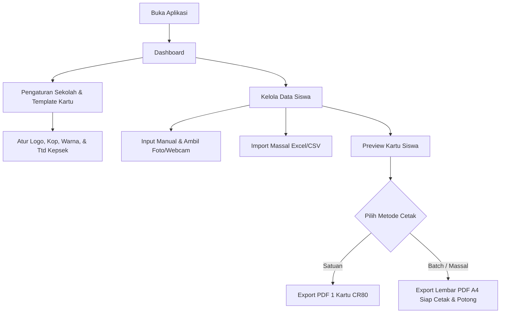
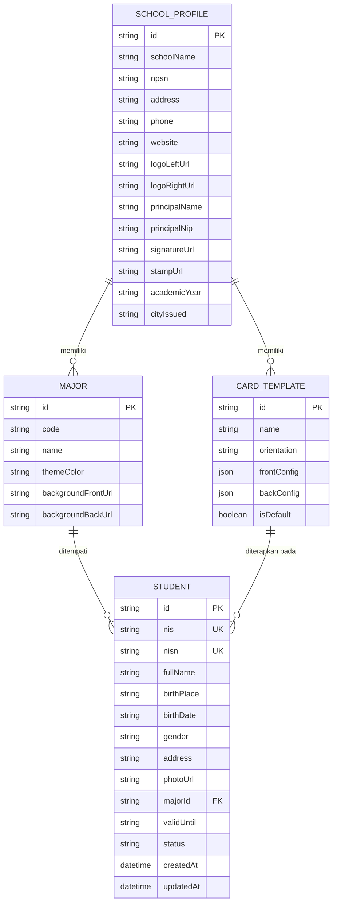

# Product Requirement Document (PRD)
## Aplikasi Manajemen & Generator Kartu Pelajar (Student Card Generator)

---

### 1. Ringkasan Eksekutif & Tujuan Produk
Aplikasi **Generator & Manajemen Kartu Pelajar** adalah platform berbasis web yang dirancang untuk mempermudah staf Tata Usaha (TU) atau Operator Sekolah dalam mengelola data identitas siswa serta memproduksi (mendesain, men-generate, dan mencetak) kartu pelajar standar ID Card secara cepat, massal, dan presisi.

#### Sasaran Utama:
1. **Efisiensi Input Data**: Mendukung entri data siswa secara individual maupun massal via berkas Excel/CSV.
2. **Fleksibilitas Desain**: Menyediakan kustomisasi template kartu (depan & belakang, logo sekolah, warna tema, background, tanda tangan/stempel kepala sekolah).
3. **Presisi Cetak**: Menghasilkan dokumen cetak PDF siap cetak dengan dimensi standar kartu ID (ISO/IEC 7810 ID-1 / CR80: 85.60 mm × 53.98 mm), lengkap dengan grid layout untuk kertas ukuran A4 atau F4.
4. **Keamanan & Verifikasi**: Menghasilkan barcode/QR Code otomatis berbasis NISN/Nomor Induk Siswa.

---

### 2. Pengguna & Hak Akses
- **Target Pengguna**: Staf Tata Usaha (TU), Bagian Kesiswaan, Operator IT Sekolah.
- **Tipe Akses**:
  - **Single / Multi Admin Operator**: Pengguna dapat masuk ke sistem dashboard untuk mengelola data siswa, mengatur template kartu, dan mengunduh berkas cetak. Tidak memerlukan portal publik atau akun siswa terpisah.

---

### 3. Ruang Lingkup & Spesifikasi Fitur

#### 3.1. Modul Manajemen Data Siswa
- **CRUD Siswa**:
  - Kolom data: NIS, NISN, Nama Lengkap, Tempat & Tanggal Lahir, Jenis Kelamin, Kelas/Jurusan, Alamat/Golongan Darah/Kontak Darurat (opsional), Masa Berlaku Kartu.
- **Pengambilan & Upload Foto**:
  - Upload file foto (JPG, PNG, WebP) dengan fitur crop rasio 3:4 atau 4:6 otomatis.
  - Opsi capture langsung menggunakan kamera/webcam laptop.
- **Import & Export Massal**:
  - Import data siswa via template Excel (.xlsx) / CSV.
  - Download template contoh Excel.
  - Bulk photo import (upload folder/ZIP foto dengan penamaan file berbasis NIS/NISN).

#### 3.2. Modul Template & Desain Kartu (Card Designer - Sesuai Referensi Visual)
- **Orientasi & Dimensi**:
  - **Portrait (Vertikal)** standar CR80 (54 mm × 86 mm) cocok untuk ID Card Lanyard / Holder.
  - Tersedia opsi toggle **Landscape (Horizontal)** (86 mm × 54 mm) untuk kebutuhan variasi.

- **Sisi Depan (Front Side)**:
  - **Header (Kop Kartu)**:
    - Logo kiri (Logo Tut Wuri Handayani / Kemendikbud / Logo Sekolah).
    - Teks Judul Utama: "KARTU TANDA SISWA" (tebal, kontras).
    - Nama Sekolah: Misal "SMK NEGERI 1 LABUHAN MARINGGAI".
    - Periode: "Tahun Ajaran 2026/2027".
  - **Tema & Background Dinamis Berdasarkan Jurusan / Kategori**:
    - Dukungan tema visual berbeda tiap Jurusan (misal: *DKV* bernuansa biru/kuning dengan ornamen grafis, *Perbankan* hijau Islami/geometris, *Teknik/TSM* oranye/abu-abu dengan ornamen mekanik/roda gigi).
    - Pilihan preset template jurusan siap pakai + opsi unggah background kustom sendiri.
  - **Area Pas Foto**:
    - Foto berada di tengah (centered) dengan border/bingkai elegan dan sudut rounded.
  - **Informasi Data Siswa (Format Rapi / Tabular)**:
    - `NAMA      : [NAMA SISWA]`
    - `TGL. LAHIR: [TANGGAL LAHIR]`
    - `JURUSAN   : [JURUSAN / KELAS]`
    - `ALAMAT    : [ALAMAT TINGGAL]`
    - *(Opsional tambahan: NIS / NISN)*
  - **Footer Kartu**:
    - Sisi Kiri: Barcode (Code128 otomatis dari NIS/NISN) dengan latar kontras agar mudah discan scanner barcode fisik.
    - Sisi Kanan: Logo Slogan / Akreditasi / Branding (contoh: Logo "SMK BISA - HEBAT" atau logo yayasan/sekolah).

- **Sisi Belakang (Back Side)**:
  - **Ketentuan & Tata Tertib Penggunaan Kartu**:
    1. Kartu ini adalah bukti identitas resmi siswa/siswi yang bersangkutan.
    2. Kartu tidak boleh dipindahtangankan kepada orang lain.
    3. Apabila kartu hilang atau rusak, segera lapor ke bagian Tata Usaha Sekolah.
    4. Barang siapa menemukan kartu ini dimohon mengembalikan ke alamat sekolah tertera.
  - **Pengesahan & Otorisasi**:
    - Tempat & Tanggal Penerbitan (misal: *Labuhan Maringgai, 15 Juli 2026*).
    - Jabatan: "Kepala Sekolah".
    - Gambar Tanda Tangan Digital & Stempel Basah Sekolah (format PNG transparan).
    - Nama Lengkap Kepala Sekolah beserta NIP / NUPTK.
  - **Footer Sisi Belakang**:
    - Informasi Kontak Sekolah: Alamat lengkap, nomor telepon, email, dan alamat website sekolah.
    - QR Code Verifikasi URL (opsional: link verifikasi keabsahan siswa).

#### 3.3. Modul Preview & Export / Print Engine
- **Live Preview Real-Time**: Tampilan kartu interaktif (bolak-balik) sebelum dicetak.
- **Pencetakan Satuan**: Cetak 1 kartu terpilih.
- **Pencetakan Massal (Batch Print)**:
  - Generate PDF lembaran (misal: 1 halaman A4 berisi 8-10 kartu siap potong).
  - Dilengkapi garis potong (*crop marks / cutting guidelines*).
  - Pengaturan margin dan bleed (2-3 mm) untuk cetak mesin printer PVC ID Card.

---

### 4. Arsitektur Teknis yang Diusulkan

| Komponen | Pilihan Rekomendasi | Keterangan |
| :--- | :--- | :--- |
| **Frontend Framework** | **Next.js (React 19 / App Router)** | SSR/SSG cepat, UI responsif, developer-friendly |
| **Styling & UI Library** | **Tailwind CSS + shadcn/ui + Lucide Icons** | Tampilan modern, bersih, dan profesional |
| **Penyimpanan Data** | **SQLite (via Prisma / Drizzle ORM)** | Ringan, portable, tanpa setup server database rumit (bisa diupgrade ke PostgreSQL jika perlu) |
| **Cetak PDF Engine** | `@react-pdf/renderer` atau `jsPDF` + `html2canvas` | Render layout kartu presisi ukuran milimeter (CR80) |
| **Generator QR/Barcode** | `qrcode` & `jsbarcode` | Ringan dan dieksekusi client-side / server-side |
| **Pengolah Foto & Webcam** | `react-easy-crop` + `react-webcam` | Crop foto presisi dan integrasi kamera langsung |
| **Import Excel** | `xlsx` / `exceljs` | Parsing data siswa dan template download |

---

### 5. Alur Kerja Pengguna (User Flow)



---

### 6. Rencana Tahapan Pengerjaan (Milestones)

1. **Milestone 1**: Inisialisasi Proyek, Konfigurasi Basis Data, dan Setup UI Dasar.
2. **Milestone 2**: Manajemen Siswa (CRUD, Upload/Webcam Foto, Import Excel).
3. **Milestone 3**: Desainer & Engine Template Kartu (Depan, Belakang, QR/Barcode).
4. **Milestone 4**: Engine PDF Generator (Preview, Presisi CR80, dan Batch Print A4).
5. **Milestone 5**: Pengujian, Polish Tampilan, dan Dokumentasi Panduan Cetak.

---

### 7. Skema Basis Data (Database Schema & Entities)

Aplikasi menggunakan basis data relasional ringan (**SQLite**) yang dikelola melalui ORM (**Prisma**). Skema dirancang modular agar mudah diekspor atau dipindahkan jika diperlukan.



#### Deskripsi Field Kunci:
1. **SchoolProfile**: Menyimpan data identitas sekolah tunggal (nama, NPSN, kop, logo dinas, logo sekolah, ttd kepala sekolah, dan stempel basah transparan).
2. **Major**: Menyimpan daftar jurusan/program keahlian beserta konfigurasi visual warna tema dan background kartu khusus tiap jurusan.
3. **Student**: Entitas data siswa yang mencakup data akademik, demografi, file foto pasfoto, dan tanggal kedaluwarsa kartu.
4. **CardTemplate**: Menyimpan konfigurasi posisi elemen, warna teks, visibilitas barcode/QR code dalam format JSON yang fleksibel.

---

### 8. Spesifikasi Teknis Cetak & PDF Engine

Presisi dimensi adalah parameter paling kritis dalam pencetakan kartu pelajar fisik agar pas pada holder/casing mika dan plastik laminasi standar.

| Parameter | Spesifikasi Standar | Keterangan Teknis |
| :--- | :--- | :--- |
| **Standar Kartu** | ISO/IEC 7810 ID-1 (CR80) | Standar internasional kartu ATM/KTP/SIM |
| **Dimensi Fisik** | 85.60 mm × 53.98 mm | Toleransi cetak ±0.5 mm |
| **Orientasi Default** | Portrait: 53.98 mm (L) × 85.60 mm (T) | Dilengkapi opsi Landscape (85.60 × 53.98 mm) |
| **Corner Radius** | 3.18 mm (rounded corners) | Panduan visual sudut lengkung kartu |
| **Resolusi Cetak** | 300 DPI | 638 px × 1012 px (kualitas tajam tanpa pecah) |
| **Bleed Area** | 1.5 mm – 2 mm | Lebihan desain untuk mengantisipasi pergeseran pisau potong |
| **Garis Potong (Crop Marks)** | Garis tipis 0.25 pt warna abu-abu/hitam | Memandu operator saat memotong menggunakan paper cutter |

#### Mode Output Pencetakan:
1. **Single Card PDF**:
   - 1 halaman PDF khusus berisi 1 kartu depan & belakang ukuran pas CR80 (cocok untuk printer langsung PVC ID Card seperti Fargo, Zebra, Evolis).
2. **Batch A4 Paper (Kertas Glossy / PVC Inkjet 3 lapis)**:
   - Layout 2 kolom × 4 baris (8 kartu) atau 2 kolom × 5 baris (10 kartu per lembar).
   - Dilengkapi margin aman kertas (top/bottom/left/right 10 mm).
   - Opsi cetak sisi depan seluruhnya, lalu sisi belakang (duplex alignment).
3. **Tray Printer Khusus (Epson L805 / L8050 ID Card Tray)**:
   - Layout template 2 kartu berdampingan sesuai ukuran tray plastik PVC bawaan printer.

---

### 9. Arsitektur Komponen & Strategi Penyimpanan File

```
src/
├── app/
│   ├── (dashboard)/
│   │   ├── page.tsx               # Dashboard Utama & Ringkasan Statistik
│   │   ├── siswa/
│   │   │   ├── page.tsx           # Tabel Data Siswa & Aksi
│   │   │   └── import/page.tsx    # Halaman Import Excel & Upload Massal Foto
│   │   ├── template/
│   │   │   └── page.tsx           # Card Designer & Pengaturan Tema Jurusan
│   │   ├── cetak/
│   │   │   └── page.tsx           # Cetak Massal (Batch Print & PDF Engine)
│   │   └── pengaturan/
│   │       └── page.tsx           # Profil Sekolah, Logo, TTD, & Stempel
│   ├── api/
│   │   ├── students/              # REST / Route handlers data siswa
│   │   ├── export/                # Endpoint download PDF/Excel
│   │   └── upload/                # Endpoint upload foto/aset
├── components/
│   ├── card/                      # Komponen Render Kartu (Depan, Belakang, Barcode)
│   ├── ui/                        # Komponen Reusable UI (Button, Modal, Input, Badge)
│   └── camera/                    # Komponen Webcam Capture & Image Cropper
├── lib/
│   ├── db.ts                      # Inisialisasi Prisma Client SQLite
│   ├── pdf-generator.ts           # Logika rendering PDF presisi mm
│   └── excel-parser.ts            # Logika baca & tulis file Excel
└── types/
    └── index.ts                   # Type definitions TypeScript
```

#### Pengelolaan Berkas Foto:
- Foto siswa disimpan pada direktori lokal `./public/uploads/students/` dengan penamaan file konsisten: `{nis}_{timestamp}.jpg`.
- Gambar logo, tanda tangan, dan stempel sekolah disimpan pada `./public/uploads/assets/`.
- Foto otomatis dikonversi/dikompres ke format WebP/JPEG kualitas 85% untuk efisiensi penyimpanan dan kecepatan render PDF.

---

### 10. Rincian Antarmuka Pengguna (UI/UX Specification)

1. **Dashboard Utama**:
   - Widget ringkasan: Total Siswa, Siswa Siap Cetak (Foto Lengkap), Siswa Belum Ada Foto, Kartu Sudah Dicetak.
   - Quick Actions: "Tambah Siswa Baru", "Import Excel", "Buka Studio Cetak".
   - Preview cepat kartu perwakilan dari masing-masing jurusan.

2. **Manajemen Data Siswa**:
   - Tabel responsif dilengkapi pagination, pencarian instan (nama/NISN), filter per kelas/jurusan, dan filter status kelengkapan foto.
   - Form Tambah/Ubah Siswa:
     - Input data tabular rapi.
     - Widget foto interaktif: drag-and-drop file atau klik "Buka Webcam" untuk jepret langsung di tempat dengan panduan garis oval wajah (*face guide overlay*).
     - Tool pemotong foto (cropper) aspek rasio tetap 3:4.

3. **Card Designer & Pengaturan Sekolah**:
   - Live Preview interaktif (dapat dibalik depan-belakang dengan animasi 3D flip).
   - Pengaturan warna aksen dan background per jurusan secara visual.
   - Upload tanda tangan kepala sekolah & stempel basah (dilengkapi tombol hapus background otomatis/transparan).

4. **Studio Cetak Massal**:
   - Seleksi multi-pilih (checkbox) siswa dengan opsi: "Pilih Semua", "Pilih Per Jurusan/Kelas", "Pilih Yang Belum Dicetak".
   - Panel konfigurasi cetak:
     - Pilihan jenis kertas (A4, F4, Single Card CR80, atau PVC Tray).
     - Pengaturan margin dan jarak antar kartu (spacing).
     - Toggle garis potong (*crop marks*).
     - Preview lembar cetak interaktif (WYSIWYG) sebelum file PDF di-download.

---

### 11. Kebutuhan Non-Fungsional (Non-Functional Requirements)

1. **Kemandirian Sistem (Standalone / Offline-Capable)**:
   - Dapat dijalankan secara lokal di PC sekolah (Localhost) tanpa harus bergantung pada koneksi internet stabil.
2. **Performa Rendering**:
   - Waktu pemrosesan pembuatan file PDF untuk 100 kartu di bawah 5 detik.
   - Rendering UI kartu di browser harus instan (60 FPS) tanpa lag saat mengetik data.
3. **Privasi & Keamanan Data Siswa**:
   - Data siswa disimpan di database lokal di komputer sekolah, menghindari risiko kebocoran data pribadi (UU Perlindungan Data Pribadi / PDP).
4. **Kompatibilitas Printer**:
   - Output PDF teruji presisi 1:1 saat dicetak menggunakan Adobe Acrobat Reader / Browser dengan opsi *Actual Size* (Skala 100%).

---

### 12. Kriteria Penerimaan (Acceptance Criteria / Definition of Done)

- [ ] Pengguna dapat menginput data sekolah lengkap beserta logo dan tanda tangan.
- [ ] Pengguna dapat menambah siswa satu per satu lengkap dengan foto via upload berkas atau kamera webcam.
- [ ] Pengguna dapat mengimpor puluhan data siswa sekaligus dari file Excel (.xlsx).
- [ ] Kartu menampilkan tema visual, ornamen, dan warna berbeda secara otomatis sesuai jurusan siswa.
- [ ] Barcode Code128 / QR Code pada kartu dapat dibaca dengan lancar oleh scanner fisik atau aplikasi smartphone.
- [ ] Sisi depan dan sisi belakang kartu dapat di-preview secara akurat di layar.
- [ ] Fitur cetak menghasilkan PDF dengan ukuran tepat standar CR80 (85.6 mm × 53.98 mm) saat dicetak pada skala 100%.
- [ ] Fitur batch print menyusun kartu pada kertas A4 dengan grid rapi dan garis potong yang presisi.

---

### 13. Langkah Eksekusi Selanjutnya

1. **Setup Dependensi Inti**:
   - Instalasi modul database & ORM (`prisma`, `@prisma/client`).
   - Instalasi modul utilitas (`lucide-react`, `clsx`, `tailwind-merge`, `xlsx`, `jsbarcode`, `qrcode`, `jspdf`, `html2canvas`).
2. **Inisialisasi Database SQLite & Seed Awal**:
   - Membuat schema Prisma (`schema.prisma`) dan generate client.
   - Membuat seed data contoh: profil SMK, jurusan (DKV, TSM, Perbankan), dan beberapa data siswa contoh.
3. **Pembangunan Layout Dashboard & Fitur Profil Sekolah**:
   - Layout navigasi utama dan form pengaturan profil sekolah.
4. **Pembangunan Modul Siswa & Modul Desain Kartu**:
   - CRUD Siswa, Integrasi Crop Foto & Webcam, serta Renderer Komponen Kartu Depan & Belakang.
